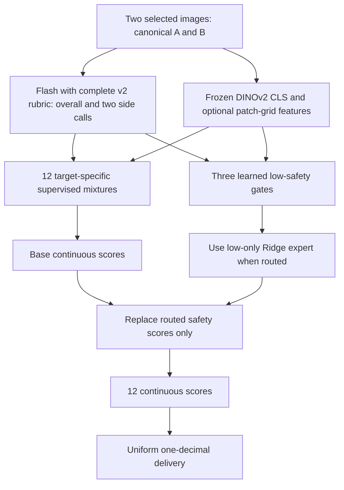

# Final frozen canonical streetview scorer

**Current status, October 25, 2026 (America/Los_Angeles):** final all-488 training,
500-point inference and reference comparison, and remaining-12,160 inference are
complete. This supersedes the pending status in the October 23 records. Run IDs
and timestamps ending in Z use UTC.

## Method and identities

- **A is the selected 0/90-degree image; B is the selected 180/270-degree image.**
  This is a canonical angular grouping, not a geographic left/right designation.
  It applies to the two images already selected by the earlier CLIP pipeline;
  this scorer does not select another pair from the original four.
- Normalize identities before training or inference. If the recorded images are
  reversed, move the image paths, cached side Flash scores, DINO feature rows and
  all four associated reference columns together. Ten of 488 development points,
  220 of 500 validation points and 5,965 of 12,160 batch points needed a slot reorder.
- This is metadata-based identity normalization. It does not minimize reference
  error and does not prove what side a historical annotator visually intended.
  Cached overall development scores are retained; symmetric overall DINO features
  and the overall reference are unchanged by reordering the pair.
- During new Flash inference, overall receives A then B; each side call receives
  only that side's image. Filename, side and angle text are placed beside each image.
  Overall is scored independently, not the mean of the side scores.

## Frozen Flash and image features

Use `qwen3.8-flash` at DashScope Beijing's compatible chat endpoint. No finer
provider backend snapshot identifier is available in the recorded responses.
Use the complete **v2_organized** rubric prompt, temperature 0, thinking disabled,
JSON-object output, and maximum 900 output tokens. Three requests per point each
return four scores plus one <=40-character evidence string per dimension.
Original image bytes are sent as PNG base64 data URLs, with no new ROI crop.
No reference scores or reference examples are sent.

The public prompt fragments still require the private PDF-derived rubric;
the fragment text alone is not the complete prompt. Complete rubric-prompt SHA-256:

| Scope | SHA-256 |
|---|---|
| Overall | `8ed80087c0109d4bf6313931982439ff2924a6b55bb439285d34b6c4b2731f36` |
| Side A and Side B | `9d97bb49c0f85f8f8904522656fafb3a4065693d04cc1d663e5abeda0fd1da1f` |

The dynamic filename/angle/identity context is additional to the hashed static
rubric text. Per-request payload and image hashes remain in private manifests.
Legal raw VLM anchors remain 0, 0.1, 0.2, 0.4, 0.5, 0.6, 0.8, 0.9, 1 or NA.
Lossless numeric strings at these anchors are accepted without changing raw JSON.

DINO is `facebook/dinov2-small`, revision
`ed25f3a31f01632728cabb09d1542f84ab7b0056`, frozen on CPU. Apply EXIF orientation, RGB conversion,
shortest-side 224 resizing with dimensions rounded to multiples of 14, bicubic
interpolation and the recorded normalization; no crop. Each image has a 384-D CLS
vector. Grid-capable safety gates concatenate CLS with six mean-pooled 2x3
patch-token cells (2,688-D total). Overall features concatenate the pair mean
and absolute difference; side features use their own image only.

## Supervised mixture and low-safety module

The [historical base specification](scoring_method_2026-10-23.md) explains the
hierarchy: target-specific regression/calibration blends, SVR blends and score
probability decoders. The four Flash scores and four missing indicators belong
to the same scope. Image PCA, imputation and scaling are fitted on training rows.
Maintenance keeps the first-stage blend; the other targets may use later stages.
Selected component weights vary by target, rather than averaging all methods
with one global weight. Raw NA is handled by the fitted imputation/fallback
policy, not treated as a zero label.

For each safety scope, a classifier predicts whether to route to a Ridge expert
trained only on development rows with reference <=0.3. Expert outputs are clipped
to [0,0.3]; unrouted rows retain the base score. The nine other targets remain
exactly equal to their base outputs. Flash and DINO themselves are not fine-tuned.
Final configurations, selected using development-only folds:

| Safety scope | Image features | Routing classifier | Threshold | Ridge alpha | Low training rows |
|---|---|---|---:|---:|---:|
| `overall_pedestrian_safety` | grid | logistic | 0.6 | 100 | 69 |
| `side_A_pedestrian_safety` | cls | logistic | 0.7 | 100 | 74 |
| `side_B_pedestrian_safety` | grid | hist_gradient_boosting | 0.7 | 1000 | 82 |

Both logistic gates use C=0.01 and balanced class weights. The histogram gate
uses seven maximum leaf nodes and L2 regularization 10. All three use the recorded
hard-negative weighting of 2 and 20 training-fitted image PCA components. Routing
scores are not validated confidence probabilities. Exact nested component
settings and model-file hashes are in the [final configuration](../configs/scoring/flash_v2_dino_canonical_frozen.json).

## Training, regression check and freeze

The accepted training reference yielded 773 eligible points. Keep the original
200-point historical test aside and isolate the 85 development points sharing
its spatial groups, leaving 488 development points in 400 groups. Reuse five
outer spatial folds and four inner folds; fit preprocessing and models inside
training folds only. NA targets do not become zero training labels.

After canonical normalization, rerun the spatial nested CV before validation.
`old` below means earlier fitted scheme with predictions permuted to the same
image identity; `new` means canonical retraining. `expert` includes the low-safety
module; `base` does not. All arms have 5,856 evaluable items.

| Development OOF arm | Precision | Within 0.1 | MAE | Large errors |
|---|---|---:|---:|---:|
| old_base | continuous | 66.31% | 0.08969 | 147 / 5856 |
| old_base | rounded | 81.71% | 0.08641 | 273 / 5856 |
| new_base | continuous | 66.38% | 0.08945 | 149 / 5856 |
| new_base | rounded | 81.73% | 0.08625 | 280 / 5856 |
| old_expert | continuous | 66.72% | 0.08919 | 151 / 5856 |
| old_expert | rounded | 81.88% | 0.08583 | 268 / 5856 |
| new_expert | continuous | 66.75% | 0.08922 | 156 / 5856 |
| new_expert | rounded | 81.80% | 0.08598 | 284 / 5856 |

Canonical expert retraining changed rounded hit rate 81.88% -> 81.80%, MAE
0.08583 -> 0.08598, and large errors 268 -> 284. The no-increase-in-large-errors
guard **failed**; do not call the refit an improvement on every metric. There
were 47 newly severe items and 31 resolved items. The base change accounts for
seven net errors and the changed wrapper effect for nine. Of the 47 new cases,
40 end exactly on rounded error 0.3. Reference-guided diagnosis cannot establish
actual reversals and was not used to repair training identities.

The canonical scheme was retained for consistent identity after user review of
this tradeoff. Repeated development selection is not new independent evidence.
Select final settings on development-only folds, then fit 12 base target models
and three safety wrappers on all 488 development points; these are final fits,
not an average of the outer-fold models. No validation500 reference or test200
labels enter this final fit. The same 19-file freeze (15 model files plus selection,
protocol and workflow records) is reused for validation and full inference:

`acb1db4dd55d768ac9fcdd4553706ef719c18ff8ec3831ce4aa4c66faadf481a`

## Outputs and evaluation boundaries

Keep all 12 continuous predictions in [0,1]. Deliver the uniformly rounded
version with `floor(10*p+0.5)/10`; 0.3 and 0.7 are permitted learned outputs even
though they are absent from the raw VLM anchors. The 19 columns are point ID,
folder path, image A, image B, angle A, angle B, method version, then four scores
for each of overall, Side A and Side B. Neither inference nor rounding uses a
new point's reference or reference-selected A/B exchange.

The final canonical extension has [500-point validation evidence](validation500_2026-10-25.md).
The historical 200-point base results must not be relabelled as extension results.
[Full batch completion](full_scoring_2026-10-25.md) establishes coverage and
correspondence, not full-dataset accuracy. [A/B swaps](ab_dimension_diagnostic_2026-10-25.md)
are a separate reference-guided diagnostic and never enter the automatic delivery.

Only English methods, non-identifying aggregate evidence, hyperparameters and
hashes are public. Original images, full private rubric, coordinates, split
memberships, reference rows, fitted coefficients and per-point outputs remain
local. This archive is not a turnkey reproduction package.
