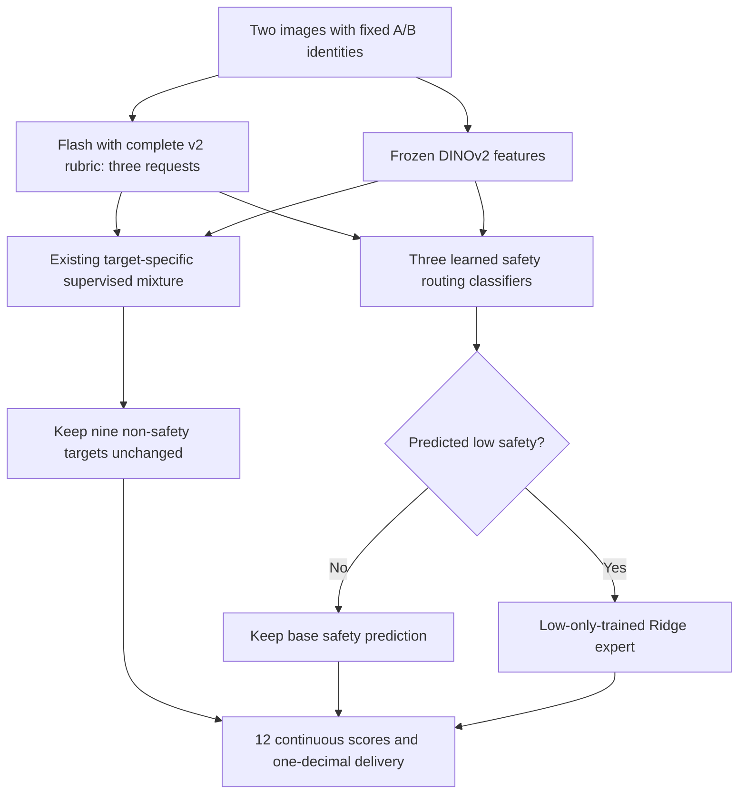

# Selected low-safety extension and October 23 follow-up

> **Historical development record:** the final canonical all-488 refit, 500-point
> validation and remaining-12,160 inference are now complete. See the
> [final method](scoring_frozen_2026-10-25.md). The development metrics below
> remain the original experiment, not the later canonical refit or validation.

The user selected **Flash v2 + frozen DINOv2 + the existing supervised mixture,
with a two-step low-safety extension**, for the next validation stage. Deliver
one-decimal scores and retain continuous scores. At that milestone, the extension was selected as a
method, not yet a newly validated production model. No 500-point validation or
full-dataset scoring was run in this documentation update.

The [historical base-method report](scoring_method_2026-10-23.md) and its 200-point
test scores remain intact. Those test scores do **not** describe the extension.
The [A/B matching diagnostic](ab_dimension_diagnostic_2026-10-23.md) is separate;
its gains are not added to the automatic pipeline's results.

## Inference method

The complete private PDF-derived rubric is inserted into the archived v2 prompt
fragments. Flash outputs four scores plus short evidence per request: overall
uses both images, each side its own image. Overall is not the average of sides.
Flash and DINOv2 are not fine-tuned. Reference scores are training targets, never
features supplied for predicting new points.

For each of the three safety targets, train a binary routing classifier with
label `reference <= 0.3`. Candidate inputs are same-scope Flash scores and missing
flags plus 20 train-only PCA components of frozen CLS or CLS+2x3 patch-grid
features. Candidate routing classifiers are logistic regression and shallow
histogram gradient boosting, with optional training-only hard-negative weights.
Routing scores are not calibrated confidence probabilities.

Train a Ridge expert only on low-reference rows in the active training fold;
clip its predictions to [0, 0.3]. If the routing score reaches its inner-selected
threshold, use the expert; otherwise use the base mixture. This is learned
routing and regression, not a rule that keeps every low Flash score or assigns
every suspected case the same low value. Other nine targets remain unchanged.

Keep the established image identity throughout. A/B does not imply geographic
left/right; no reference-guided A/B exchange occurs in automatic inference.
Use `floor(10*p+0.5)/10` uniformly and retain unrounded output.

## Development design and selection status

Use the same 488 development points, 400 spatial groups, five outer folds and
four inner folds. The 85 buffer points, 200 evaluated test labels and future
500 validation labels were not used in this extension experiment. Preprocessing
and expert fitting use active training rows only. Reused cached base inner
predictions come from outer-training-only fits; the base and wrapper reuse inner
validation evidence. Earlier prompt development and repeated experiment selection
still limit the independence of development estimates.

There are 225 low-safety scoring items from 100 points in 95 groups, not 225
independent samples. Each scope is modeled separately. All 15 outer-fold safety
fits selected an expert; the nine remaining targets exactly reproduce the base.
Saved models were reloaded and predictions replayed; selections were independently
checked. No new Qwen calls or labels were needed.

The original base already has a private all-488 fit. At that milestone the extension had
15 outer-fold safety models, not a completed all-488 final wrapper. Before the
next validation, select final safety configurations from development-only folds
and refit on all 488; freeze them and predictions before opening validation
reference scores. This documentation update does not perform that training.

## Main results: fixed A/B, one decimal, development OOF

| Metric | Base mixture | Low-safety extension |
|---|---:|---:|
| Low safety within 0.1 (225 items) | 56.00% | 66.67% |
| Low safety MAE | 0.1796 | 0.1484 |
| Low safety errors >=0.3 | 59 | 50 |
| Nonlow safety within 0.1 (1,239 items) | 78.85% | 77.72% |
| Nonlow safety MAE | 0.0945 | 0.0974 |
| Nonlow safety errors >=0.3 | 56 | 60 |
| All 12 within 0.1 (5,856 items) | 81.71% | 81.88% |
| All 12 MAE | 0.08641 | 0.08583 |
| All 12 errors >=0.3 | 273 | 268 |

Low-safety hit rate improved in every outer fold. A fixed-prediction paired
spatial bootstrap estimates a +10.67 pp low-safety gain (95% interval +5.76 to
+16.06 pp); overall hit gain is only +0.17 pp and its interval includes zero.
These intervals exclude refitting and experiment-search uncertainty.

**Tradeoff explicitly accepted after review:** nonlow safety hit rate fell
1.13 pp, exceeding the predeclared 1 pp guard. The other three promotion checks
passed, but the experiment did not pass every original gate. User selection does
not turn that failure into a pass. True-zero safety remains difficult: within-0.1
stayed 13.33% on 15 zero-reference items. Do not describe all low sublevels as solved.

Continuous scores tell a somewhat different story: all-target hit rate increased
66.31% -> 66.72%, MAE decreased 0.08969 -> 0.08919, but errors >=0.3 increased
147 -> 151. Preserve both precisions rather than implying every metric improves.

## All 12 targets, one decimal

| Target | Base within 0.1 | Extension within 0.1 | Base MAE | Extension MAE | Base errors >=0.3 | Extension errors >=0.3 |
|---|---:|---:|---:|---:|---:|---:|
| overall_pedestrian_safety | 76.64% | 78.07% | 0.1006 | 0.0973 | 26 | 27 |
| overall_street_interface | 78.89% | 78.89% | 0.0928 | 0.0928 | 29 | 29 |
| overall_greenery_staying | 93.24% | 93.24% | 0.0598 | 0.0598 | 4 | 4 |
| overall_environmental_maintenance | 90.98% | 90.98% | 0.0631 | 0.0631 | 6 | 6 |
| side_A_pedestrian_safety | 76.23% | 76.84% | 0.1051 | 0.1033 | 41 | 38 |
| side_A_street_interface | 73.98% | 73.98% | 0.1023 | 0.1023 | 28 | 28 |
| side_A_greenery_staying | 83.61% | 83.61% | 0.0781 | 0.0781 | 9 | 9 |
| side_A_environmental_maintenance | 90.57% | 90.57% | 0.0561 | 0.0561 | 9 | 9 |
| side_B_pedestrian_safety | 73.16% | 73.16% | 0.1170 | 0.1152 | 48 | 45 |
| side_B_street_interface | 72.95% | 72.95% | 0.1133 | 0.1133 | 47 | 47 |
| side_B_greenery_staying | 79.51% | 79.51% | 0.0893 | 0.0893 | 20 | 20 |
| side_B_environmental_maintenance | 90.78% | 90.78% | 0.0592 | 0.0592 | 6 | 6 |

## Follow-up alternatives tested today

| Experiment | Comparable evidence | Decision |
|---|---|---|
| Conservative cap on base correction | Same 488 dev points: rounded hit 81.71% -> 81.71%, MAE 0.08641 -> 0.08644, large errors 273 -> 269 | No general replacement |
| Learned raw/base gate | Same 488 dev points: rounded hit 81.71% -> 81.44%, large errors 273 -> 277; low safety hit 56.00% -> 61.33% | Low-band benefit did not offset other harm |
| Original image + grounded ROI | Separate 24-point selected pilot, 144 safety/interface items: raw within-0.1 66.67% -> 69.44%, MAE 0.1340 -> 0.1250, large errors 20 -> 19 | Hard-case MAE gain 0.01146 was below the fixed 0.02 requirement; not promoted |
| CLS + fixed 2x3 DINO grid | Same 488 dev points: rounded hit 81.71% -> 82.22%, MAE 0.08641 -> 0.08530, large errors 273 -> 272 | Low safety hit 56.00% -> 55.56%; pooled hit-gain interval includes zero; not selected as blanket replacement |
| Two-step low-only expert | Same 488 dev points; results above | User-selected next-validation method with explicit nonlow tradeoff |

The ROI pilot uses different points and raw VLM scores, so do not rank its rates
against the 488-point supervised rates. It made 192 valid locator/scoring calls
under prior authorization; equal-input controls also showed cloud variability.
The other three follow-ups reused local cached predictions/features with no new
Qwen calls. Grid candidates remain eligible inside the selected safety wrapper;
the unselected blanket grid refit is not stacked underneath it.

## Historical reproducibility and next-stage boundary

These pending-stage statements describe October 23. The final all-488 wrapper
and subsequent scoring are documented in the [current method](scoring_frozen_2026-10-25.md).

- [Extension specification](../configs/scoring/flash_v2_dino_low_safety.json):
  classifier/expert grids, routing thresholds, guards, preprocessing and the
  15 outer-fold choices. These are not final all-488 selected coefficients.
- [Aggregate extension evidence](../results/scoring_2026-10-23/low_safety_expert.json):
  both precisions, all 12 targets, folds, score bands and acceptance checks.
- Original images, coordinates, references, per-point scores, spatial memberships,
  fitted artifacts and full rubric text remain private. Public aggregates include
  source experiment identifiers and SHA-256 hashes for traceability.
- Future 500-point validation: fixed A/B automatic scores are primary; report
  any reference-guided A/B matching separately as posthoc diagnosis. Do not tune
  on that validation and still call it an independent test of the same method.
- Future full dataset: automatic inference only; reference-guided matching is
  unavailable without reference scores. No batch had started at that milestone;
  the [12,160-point batch](full_scoring_2026-10-25.md) is now complete.
