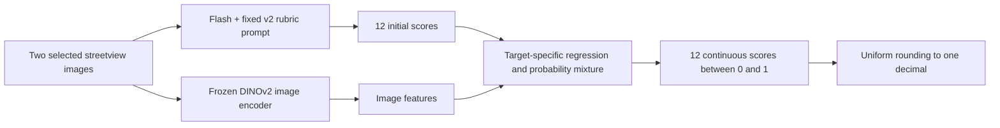

# Historical frozen base scoring method

> **Latest decision:** the user subsequently selected a low-safety extension for
> the next validation stage. See the [updated method](scoring_low_safety_extension_2026-10-23.md).
> The independent 200-point results below apply only to this historical base.

**Historical decision: retain Flash with prompt v2, retain DINOv2, and deliver uniformly
rounded one-decimal scores. Keep continuous predictions for analysis. Full-dataset
VLM scoring has not been started.** Dates in this update use UTC; the experiments
span October 22–23 UTC.

This is the scoring phase, separate from the earlier CLIP classifier that chose
two side-facing images out of four. DINOv2 is the visual encoder's name; its
“v2” has no relationship to the version of the Qwen scoring prompt.

## How it works

Training uses the accepted team reference scores to learn the lightweight
components. Scoring a new point does **not** require its reference scores.
Neither Flash nor DINOv2 is fine-tuned.

There are four dimensions—pedestrian safety, street interface, greenery/staying,
and environmental maintenance—at three scopes: overall, Side A, and Side B.
Overall is predicted independently from both images; it is not replaced with
the mean of the two side scores. A/B preserve the established image-to-reference
mapping and should not be interpreted as geographic left/right without metadata.

## Frozen inputs and model stages

1. **Flash:** `qwen3.8-flash`, archived `v2_organized` prompt, temperature 0,
   thinking disabled, JSON object output, maximum 900 output tokens. Each point
   needs three requests: both images for overall and one corresponding image
   for each side. Each response contains four scores and short evidence.
   Full private scoring rubrics are inserted into the public prompt fragments;
   the fragments alone are not the complete prompt. Temperature 0 is not a
   guarantee of identical cloud responses across runs.
2. **DINOv2:** frozen `facebook/dinov2-small`, revision
   `ed25f3a31f01632728cabb09d1542f84ab7b0056`. Extract 384-dimensional CLS features
   per image. Resize the shortest side to 224, round dimensions to multiples of
   14, use bicubic interpolation and the recorded normalization; no crop.
   Overall uses the concatenated mean and absolute difference of the two
   features (768 dimensions); each side uses only its own image (384).
3. **Base regression and calibration:** candidates include raw Qwen scores,
   nonnegative affine and isotonic calibration, DINO Ridge, and unweighted or
   score-band-weighted DINO + Qwen Ridge. The Qwen portion consists of the
   corresponding scope's four scores and four fixed missing indicators.
   Select a base unweighted fusion Ridge and a guarded blend using development
   predictions. No reference scores enter the inference features.
4. **Tolerance and probability stages:** for the nine non-maintenance targets,
   compare RBF SVR candidates and blends, then compare score-probability
   candidates and blends. These use training-only image PCA with 20 components
   plus the eight Qwen features. Decoders are the probability-weighted mean or
   a continuous center maximizing smoothed mass within ±0.1. The selected full
   fit uses logistic classifiers where a nonzero probability component is
   retained. These probabilities are not validated uncertainty estimates.
   Maintenance keeps the first-stage blend without SVR/probability additions.
5. **Output:** keep the continuous result and compute
   `floor(10 * score + 0.5) / 10` for every delivered score. Do not round the
   reference, selectively round difficult targets, or change predictions based
   on their test errors. The learned outputs may include 0.3 and 0.7 even when
   the original VLM rubric anchors do not.

This is a hierarchical, target-specific mixture—not one global average and not
just a single Ridge regression. The full parameter grids, chosen components,
prompt hashes, image preprocessing and delivery policy are in
[`flash_v2_dino_decimal.json`](../configs/scoring/flash_v2_dino_decimal.json).
Private fitted coefficients and training data remain local.

## Development and final-fit procedure

The accepted reference yielded 773 eligible points. The original 200-point
holdout was retained, leaving a 573-point development pool. Spatial checks
identified 85 development points sharing groups with the holdout; these were
isolated, leaving **488 development points in 400 spatial groups**.

Development comparisons use the exact same five outer spatial folds. Each
outer fold leaves out 97 or 98 points and trains on 390 or 391. The training
portion has four inner spatial folds for parameter selection. Imputation,
scaling, PCA, sample weights and component fitting use only the corresponding
training portion. The 12 scores are correlated targets, not 12 independent
training samples per point.

Base-blend selection balances ordinary MAE and low/middle/high-band MAE, with
guards against deterioration in low/high bands and large errors. Later stages
prioritize the ≤0.1 hit rate subject to MAE and large-error guards. These are
development selection rules, not guarantees about unseen points.

After selecting the method, the original development five folds were used to
select final target-specific components. Those components were then refitted
on all 488 points. The final model is **not** an average of the five outer-fold
models. Predictions on the independent 200 points were frozen before comparison
with their reference scores. The additional 500-point validation set was not used.

The current delivery preference for one decimal was confirmed **after** the
test results were reviewed. Rounding itself had already been fixed and tested
on development data, and both precisions were specified before the 200-point
evaluation. Continuous scoring remains the historical primary endpoint; the
delivery decision does not retroactively change that endpoint.

## Independent 200-point evaluation

The 200 points span 180 spatial groups and provide 2,400 numeric reference
scores. “Within 0.1” is an empirical tolerance hit rate, not confidence or exact
classification accuracy. Large error means absolute error ≥0.3.

| Output | Within 0.1 | MAE | Large error ≥0.3 | Mean target CCC |
|---|---:|---:|---:|---:|
| Continuous, predeclared primary | 69.75% | 0.0861 | 2.54% | 0.7072 |
| One decimal, predeclared secondary and selected delivery format | 82.71% | 0.0824 | 4.58% | 0.6953 |

The continuous **>70%** goal was not met. The continuous pooled MAE and large-error
checks passed, but the safety-dimension MAE check did not. All predeclared checks
are retained in the [aggregate test record](../results/scoring_2026-10-23/independent_test200.json).

The paired results below show why an overall hit rate should not stand in for
every dimension's quality. Each row has 200 reference scores.

| Scope | Target | Continuous ≤0.1 | Continuous MAE | Continuous ≥0.3 | Rounded ≤0.1 | Rounded MAE | Rounded ≥0.3 |
|---|---|---|---|---|---|---|---|
| Overall | Pedestrian safety | 61.00% | 0.0973 | 3.00% | 80.00% | 0.0940 | 4.00% |
| Overall | Street interface | 65.50% | 0.0861 | 0.50% | 81.00% | 0.0850 | 2.50% |
| Overall | Greenery / staying | 83.00% | 0.0565 | 0.00% | 93.00% | 0.0485 | 1.00% |
| Overall | Environmental maintenance | 83.00% | 0.0658 | 0.50% | 91.50% | 0.0620 | 2.00% |
| Side A | Pedestrian safety | 54.00% | 0.1164 | 4.50% | 67.00% | 0.1180 | 10.00% |
| Side A | Street interface | 64.50% | 0.1042 | 6.00% | 79.00% | 0.1000 | 9.50% |
| Side A | Greenery / staying | 71.50% | 0.0793 | 1.50% | 85.00% | 0.0740 | 3.00% |
| Side A | Environmental maintenance | 84.50% | 0.0568 | 0.00% | 91.50% | 0.0530 | 0.50% |
| Side B | Pedestrian safety | 53.50% | 0.1268 | 9.00% | 74.00% | 0.1230 | 10.50% |
| Side B | Street interface | 64.50% | 0.1013 | 4.50% | 78.50% | 0.0985 | 6.50% |
| Side B | Greenery / staying | 69.50% | 0.0801 | 0.00% | 81.00% | 0.0735 | 4.00% |
| Side B | Environmental maintenance | 82.50% | 0.0625 | 1.00% | 91.00% | 0.0590 | 1.50% |

Rounding changes which predictions cross a tolerance boundary. For example,
0.64 versus a reference of 0.5 fails a ±0.1 test, while its rounded value of 0.6
passes. The higher rounded hit rate does not show improved visual recognition.
Rounding also increases the reported large-error rate and slightly lowers mean
target CCC in this test. Preserve both precisions and all these metrics.

Spatial-group bootstrap 95% intervals for the hit rate are approximately
67.61–71.90% for continuous output and 80.96–84.31% for one decimal. These are
conditional on the fixed predictions; they exclude model-retraining and cloud
repeat-run variability. Group separation is not a guarantee of disjoint roads.

## Why retain DINOv2?

A subsequent ablation retrained the same staged learner using only each scope's
four Flash v2 scores and missing indicators. It reused the 488-point spatial
outer/inner folds, parameter grids, continuous selection rules and rounding.
Pure-image candidates and image PCA necessarily disappeared. There were no new
Qwen requests, and the 200-point test was not reused for this comparison.

| Development OOF, one decimal | Within 0.1 | MAE | Large error ≥0.3 |
|---|---:|---:|---:|
| Current mixture with DINO | 81.71% | 0.0864 | 4.66% |
| Retrained mixture without DINO | 77.13% | 0.0946 | 6.86% |

Without DINO, hit rate fell in all five outer folds. The pooled difference was
−4.58 percentage points, with a conditional paired spatial-bootstrap 95%
interval of approximately −5.60 to −3.57 points. Safety and greenery account for
much of the loss; maintenance depends less on the visual features.

| Scope | Target | With DINO | Without DINO | Change (pp) |
|---|---|---|---|---|
| Overall | Pedestrian safety | 76.64% | 71.93% | -4.71 |
| Overall | Street interface | 78.89% | 79.30% | +0.41 |
| Overall | Greenery / staying | 93.24% | 85.86% | -7.38 |
| Overall | Environmental maintenance | 90.98% | 90.16% | -0.82 |
| Side A | Pedestrian safety | 76.23% | 68.85% | -7.38 |
| Side A | Street interface | 73.98% | 68.65% | -5.33 |
| Side A | Greenery / staying | 83.61% | 72.54% | -11.07 |
| Side A | Environmental maintenance | 90.57% | 90.16% | -0.41 |
| Side B | Pedestrian safety | 73.16% | 65.78% | -7.38 |
| Side B | Street interface | 72.95% | 68.24% | -4.71 |
| Side B | Greenery / staying | 79.51% | 72.95% | -6.56 |
| Side B | Environmental maintenance | 90.78% | 91.19% | +0.41 |

The [ablation record](../results/scoring_2026-10-23/dino_ablation.json) includes
both precisions and per-fold results. This is repeated development evidence,
not another independent test and not an ablation on the 200-point holdout.

## Current status and reproducibility boundary

- **Selected:** Flash + v2 organized rubric + frozen DINO + supervised mixture;
  one-decimal delivery, continuous scores retained.
- **Not started:** full-dataset VLM scoring. The earlier image-selection batch
  is a separate completed task.
- **Not used:** the isolated 85-point buffer or the future 500-point validation
  set. The 200-point holdout has now been evaluated and cannot be treated as
  untouched data in future tuning.
- **Main limitation:** single-side safety remains materially weaker than
  greenery and maintenance. These scores are model estimates, not human labels.
- **Published:** method specification, prompt fragments, aggregate evidence,
  hashes and the retrospective [experiment log](scoring_iterations_2026-10-23.md).
  The local experimental runners, full private rubrics, spatial memberships,
  reference rows, image features and fitted model artifacts are not bundled
  here. This update is an experiment/method archive, not a turnkey public
  reproduction package or an automatic full-scoring launcher.

Scores are evaluated against the accepted team reference without asserting
independent annotation provenance beyond the available records. Earlier
AI-assisted annotation drafts and superseded reference versions are distinct
from this accepted evaluation reference. No claim of perfect human ground
truth or fully independent human annotation is made by these metrics.
